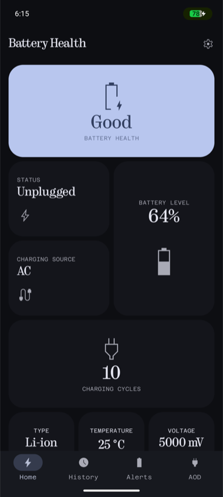
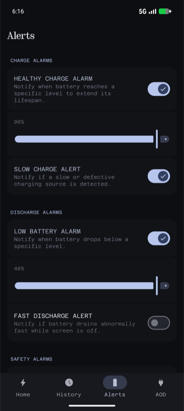
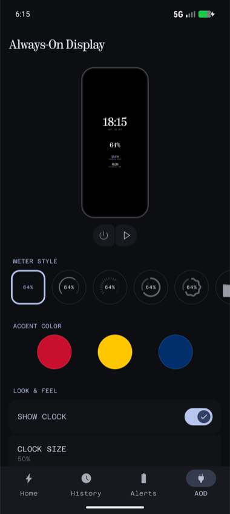
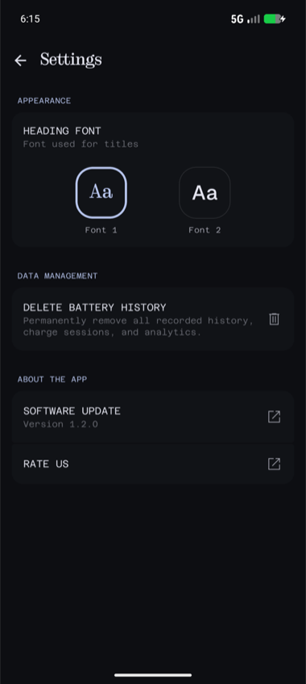

# <samp>Battery Health<samp>

<samp>Keep your battery like new, with style.<samp>
 

 

 

## <samp>Features<samp>

-   <samp>See your battery health, level, temperature and charge cycles at a glance.<samp>
-   <samp>Simple history with a chart of how you use your battery during the day.<samp>
-   <samp>Find out how fast your phone really charges.<samp>
-   <samp>Tips to make your battery last longer.<samp>
-   <samp>Choose the font you like most.<samp>
-   <samp>Available in English and Spanish.<samp>

## <samp>Premium<samp>

-   <samp>Smart alerts: unplug at the right level, slow charger, low battery, fast drain and overheating.<samp>
-   <samp>Charging clock that turns your phone into an elegant desk clock, with your own colors and style, plus flashlight and camera shortcuts.<samp>
-   <samp>Home screen widgets with your battery status.<samp>
-   <samp>Full charge history and quality analysis of every charger.<samp>

## <samp>Requirements<samp>

-   <samp>Android 7.0 or higher.<samp>
-   <samp>Notification permission to send you alerts.<samp>
-   <samp>Display over other apps permission to show the charging clock.<samp>

## <samp>Download<samp>

## <samp>Built with<samp>

   

## <samp>How to contribute<samp>

1.  <samp>Fork the repository.<samp>
2.  <samp>Clone the forked repository.<samp>
3.  <samp>Open the project with Android Studio.<samp>
4.  <samp>Add your own `google-services.json` file inside the `app` folder.<samp>
5.  <samp>Run the app on an emulator or a connected device.<samp>
6.  <samp>Make changes and create a pull request.<samp>
